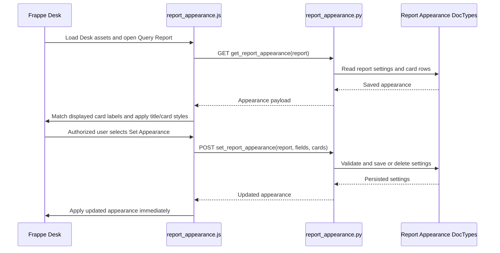

# Report Summary Customizer

Report Summary Customizer is a Frappe app that lets authorized Desk users style report titles and summary cards on the Query Report page. It stores appearance settings per report, so report authors do not need to change the report implementation just to adjust its summary presentation.

The feature is intended for administrators and report maintainers working with Script, Query, or Custom Reports that render a summary in Frappe's Query Report view. It is not a general website theme or a replacement for the report's data and summary logic.


## Installation

Run these commands from an existing Bench. Replace `<site-name>` with the target site's name.

```bash
cd /path/to/frappe-bench
bench get-app https://github.com/expert369/Report-Summary-Customizer --branch version-15
bench --site <site-name> install-app report_summary_customizer
bench build --app report_summary_customizer
bench --site <site-name> clear-cache
```

Restart the Bench's web and worker processes using the process manager for that environment. `install-app` installs the app and synchronizes its DocTypes and role fixture; the build command compiles the hooked Desk assets. To confirm installation, check that `report_summary_customizer` is listed by `bench --site <site-name> list-apps`, then open a Script, Query, or Custom Report with a summary in Desk. Assign `Report Styler` or `System Manager` to a test user to verify that **Set Appearance** is available.

If installing from a local checkout, use `bench get-app` with the repository URL/path appropriate to your environment. The repository does not provide a separate setup wizard or site-specific configuration file.

## Features

- Set a report title icon (Frappe icon or sanitized inline SVG) and title color.
- Match summary card settings by the displayed card label; set an icon, border color, and description for each matching card.
- Edit settings from a **Set Appearance** menu item on a supported report page. The item is available to users with the `Report Styler` or `System Manager` role.
- Save appearance per report and apply updates to the current page without reloading it.
- Keep styling opt-in: the custom summary-card layout is enabled only for a report with saved appearance settings.
- Remove saved settings by clearing all fields in the editor and saving.

The app changes presentation only; it does not create reports, change report queries, or generate summary values. Summary card labels are matched as displayed, so labels that differ by translation or report filters need corresponding settings.

Default Appearance


After applying Appearance


## How it works

1. `hooks.py` includes the app's CSS and JavaScript in the Frappe Desk. The assets listen for Desk route changes and act only on the `query-report` route.
2. The JavaScript waits for the active Query Report page, wraps that page's `render_summary` method, and checks for rendered summary cards. A `MutationObserver` reapplies appearance after the summary DOM changes.
3. The browser calls `get_report_appearance` for the current report. The API allows any authenticated user to read settings; guest access is rejected. Results are cached per report in the browser session.
4. A user with `Report Styler` or `System Manager` can open **Set Appearance**. The dialog is populated from the displayed report title and summary card labels.
5. Saving calls `set_report_appearance`. The server checks the role and report type, normalizes text and card JSON, sanitizes SVG, and creates or updates the `Report Appearance` document. If all fields are empty, it deletes that document.
6. The client applies the title and matching card styles to the existing DOM. CSS in `public/css/report_appearance.css` provides the custom grid and card presentation while the appearance is active.



## Architecture and codebase

```text
report_summary_customizer/
├── hooks.py                         # Desk assets, Role fixture, uninstall hooks
├── api/report_appearance.py        # Whitelisted read/write API and input checks
├── public/
│   ├── js/report_appearance.js     # Route handling, editor dialog, DOM styling
│   └── css/report_appearance.css   # Active report title/card presentation
├── report_summary_customizer/
│   └── doctype/
│       ├── report_appearance/      # One appearance document per Report
│       └── report_appearance_card/ # Child row for each styled summary label
├── fixtures/role.json              # Report Styler role fixture
├── svg.py                           # Server-side SVG validation/sanitization
├── uninstall.py                     # Cleans app-owned metadata and role
└── patches.txt                      # Patch list (currently no patches)
```

Key implementation points:

- `api/report_appearance.py`: `get_report_appearance` reads one report's appearance and ordered card settings; `set_report_appearance` checks permissions and report type, then saves or removes settings.
- `report_summary_customizer/doctype/report_appearance/report_appearance.py`: validates supported report types, keeps the linked Report immutable, validates hex colors and unique non-empty card labels, and sanitizes SVG.
- `report_summary_customizer/doctype/report_appearance_card/report_appearance_card.py`: sanitizes child-row SVG values as part of validation.
- `svg.py`: provides server-side SVG sanitization used by the API and DocType validation.
- `public/js/report_appearance.js`: hooks into Frappe route and report summary rendering, manages an in-memory appearance cache, exposes the role-gated dialog, and applies/removes styles.
- `uninstall.py`: records app-owned custom fields before uninstall and, after the module has been removed, cleans related property/layout metadata and removes the `Report Styler` role.

## Requirements and compatibility

- Python `>=3.10`, as declared in `pyproject.toml`.
- A Frappe Bench site with this app installed. Frappe is managed by Bench and is not listed as a Python package dependency in this repository.
- No Node.js dependencies or Node version are declared in this repository.
- The server API accepts `Script Report`, `Query Report`, and `Custom Report` records. The client customization targets the Frappe Desk Query Report page and its `.report-summary` / `.summary-item` DOM structure.
- The repository does not declare a supported Frappe or ERPNext version range. The Git remote currently points at `https://github.com/expert369/Report-Summary-Customizer`, and the checked-out branch is `version-15`; that branch name alone is not a compatibility guarantee.

## Configuration and usage

### Permissions

The app installs the `Report Styler` role through a Role fixture. Assign this role to users who should customize report appearance. `System Manager` is also allowed. The JavaScript hides the menu item for other users, and the whitelisted write API enforces the same role check on the server. Any authenticated user can read appearance settings; guests cannot. The `Report Appearance` DocType itself grants read/create/write/delete permissions to `System Manager`; the app's write API uses its explicit role check and saves with ignored DocType permissions.

### Customize a report

1. Open a Script, Query, or Custom Report in the Desk Query Report view and make sure it displays summary cards.
2. As a user with `Report Styler` or `System Manager`, select **Set Appearance** from the report menu.
3. Set the title icon and/or color. For each displayed summary label, optionally set an icon, description, and border color.
4. Save. The new appearance is applied to the page immediately and persists for later visits.
5. To remove the customization, clear the title and all card fields and save.

Icons may be selected using Frappe's icon field or supplied as inline SVG. SVG is sanitized server-side and filtered again in the browser. Colors must be three- or six-digit hex values (for example `#ABC` or `#AABBCC`). A customized summary card must have a non-empty label. Card appearance is associated with the label text rendered by the report; changing that label means the existing saved style will not match until updated.

### API

Both methods are whitelisted at `report_summary_customizer.api.report_appearance`:

- `get_report_appearance(report)`: GET; requires a logged-in user. Returns `{}` if no appearance is configured, or a payload containing `configured`, `icon`, `icon_svg`, `color`, and ordered `cards`.
- `set_report_appearance(report, icon=None, color=None, cards=None, icon_svg=None)`: POST; requires `Report Styler` or `System Manager`. `cards` is JSON text representing a list of card objects with `card_label`, `icon`, `icon_svg`, `border_color`, and `description` fields. It only accepts Script, Query, and Custom Reports. Empty settings delete the existing record.

These methods are internal app APIs; their request and response shape is defined by the Python implementation and the Desk client.

## Developer guide

- Keep report-specific presentation logic in the Desk asset and persistence/validation logic in the API and DocType controllers.
- When changing supported report types or matching behavior, update both server validation and client handling, and account for the Query Report page DOM rendered by the supported Frappe version.
- Preserve server-side permission checks and SVG sanitization. Client-side menu visibility is only a usability feature, not authorization.
- Summary styles are keyed by the displayed label. If changing this contract, update the editor's label collection, save payload, and application matching together.
- Add or adjust Frappe tests alongside behavior changes. The current tests use `FrappeTestCase` and cover API permissions, storage, validation, and uninstall cleanup.

Useful files to start with are `hooks.py`, `public/js/report_appearance.js`, `api/report_appearance.py`, and the two DocType definitions.

## Testing and debugging

The repository includes a Frappe test module at `report_summary_customizer/report_summary_customizer/doctype/report_appearance/test_report_appearance.py`. Run it on a configured Bench site with:

```bash
bench --site <site-name> run-tests --app report_summary_customizer
```

The tests exercise authenticated reads, role-protected writes, supported and unsupported report types, updates, validation, and uninstall cleanup. The CI workflow provisions Frappe, ERPNext, and HRMS on version-15 and has a test step, but its test-detection command searches for tests under `qgc_erp`; this checkout stores tests under `report_summary_customizer`, so that workflow may skip the app test step. This README documents the test command but does not claim a test run or pass result.

For a manual check, install/build the app, clear the site cache, grant `Report Styler`, then open a report with summary cards. Confirm the **Set Appearance** menu item appears, save a title or card style, and reload the report to confirm persistence. For browser-side failures, inspect the Desk browser console and Network panel for asset load errors and failed calls to `get_report_appearance` or `set_report_appearance`. For server-side failures, inspect the Bench site's Frappe error log and web process output.

## Troubleshooting

| Symptom | Checks |
| --- | --- |
| **Set Appearance** is missing | Confirm the user has `Report Styler` or `System Manager`, the report is open on the Desk Query Report page, and its summary has rendered cards. |
| No appearance is applied | Confirm the settings are saved for the exact Report record and that the summary card's displayed label matches the configured label. Check the browser Network panel for the GET API response. |
| Desk assets appear unchanged after an update | Rebuild with `bench build --app report_summary_customizer`, clear the site cache, and reload the browser page. |
| Save is rejected | Check the user's role, the Report type, valid three- or six-digit hex colors, unique non-empty labels, and SVG validation errors. |
| A report has no summary customization controls | The client recognizes rendered summary cards on the Query Report view. A report without summary cards cannot offer card-specific settings. |

These are troubleshooting checks based on the implementation and common Desk asset behavior, not a list of confirmed defects.

## Contributing

Contributions should include a focused change and relevant Frappe tests when behavior changes. Python linting/formatting uses Ruff as configured in `pyproject.toml` and `.pre-commit-config.yaml`; the pre-commit hooks also run ESLint and Prettier on JavaScript. Install and run the configured hooks with `pip install pre-commit`, `pre-commit install`, and `pre-commit run --all-files`. The GitHub Actions linter workflow runs the pre-commit suite on pull requests to `develop` or `version-15` and pushes to `develop`. The CI workflow targets pushes to `develop` and pull requests to `developer` or `version-15`. Include a clear description of the behavior changed and the Bench/site context used to validate it in a pull request.

## License

The app metadata declares the MIT license (`license.txt`). The license file still contains placeholder copyright values (`[year]` and `[fullname]`); replace these with the appropriate project attribution before distribution if required.
